<p align="center">
  <picture>
    <source media="(prefers-color-scheme: dark)" srcset="docs/brand/logo-dark.png">
    
  </picture>
</p>

<p align="center">
  <a href="https://github.com/asyrafmika/CampusNiaga/releases/latest"></a>
  <a href="https://asyrafmika.github.io/CampusNiaga/"></a>
  <a href="docs/qa/test-plan-and-results.md"></a>
</p>

<p align="center">
  
  
  
  
  
  
  
</p>

**CampusNiaga** is an integrated marketplace and digital-entrepreneurship platform for students of **Universiti Sains Malaysia (USM)**, built as a Final Year Project prototype (CAT404).

Today, students sell in WhatsApp and Telegram groups, where older posts get buried. CampusNiaga puts one-off personal sales and approved student micro-businesses in one place. Its **Smart Business Opportunity Discovery** compares what students ask for with what is already on sale, and explains every ranking it makes.

> [!IMPORTANT]
> Business approval is a **simulated** university reviewer workflow for this prototype. It is not an official USM or HDC decision and is not connected to any university system. CampusNiaga takes **no payments** and arranges **no delivery**: buyers and sellers pay and meet on campus themselves.

## 📑 Contents

[Features](#-features) · [Screenshots](#-screenshots) · [Architecture](#️-architecture) · [How it works](#-how-it-works) · [Quality](#-quality-and-testing) · [Try it](#-try-it) · [Getting started](#-getting-started) · [Documentation](#-documentation)

## ✨ Features

| | Module | What students and staff can do | Client |
|---|---|---|---|
| 🛍️ | **M1 Student Marketplace** | List items with photos, search with filters, reserve for campus pickup, report listings. A row lock stops double booking | Mobile |
| 📝 | **M2 Business Registration & Approval** | Apply to run a business, upload documents, answer a reviewer's questions; reviewers approve, request changes or reject | Mobile + Web |
| 🏪 | **M3 Storefront & Orders** | A storefront for each approved business, ready-stock products and capped pre-orders, orders from *pending* to *completed* | Mobile |
| 💡 | **M4 Opportunity Discovery** | Request products you can't find, tap *Interested*, and see a ranked, explained list of possible business opportunities | Mobile + DB |
| 📊 | **M5 Business Dashboard** | Orders by status, estimated revenue and profit (self-reported), top products, stock and pre-order capacity | Mobile |
| 💬 | **Deal chat** ([ADR 0004](docs/decisions/0004-deal-chat.md)) | Live chat between the buyer and seller of an accepted booking or confirmed order, read-only when the deal ends, with report and close | Mobile + Web |
| 🛡️ | **Admin dashboard** | Reviewer queue and decisions, report moderation, staff roles, account suspension, audit log | Web |

**Deliberately out of scope:** in-app payments, wallets, delivery, open-ended messaging (chat exists only inside an agreed deal), machine-learning recommendations and USM single sign-on.

## 📸 Screenshots

### 📱 Student app

<table>
  <tr>
    <td align="center" width="25%">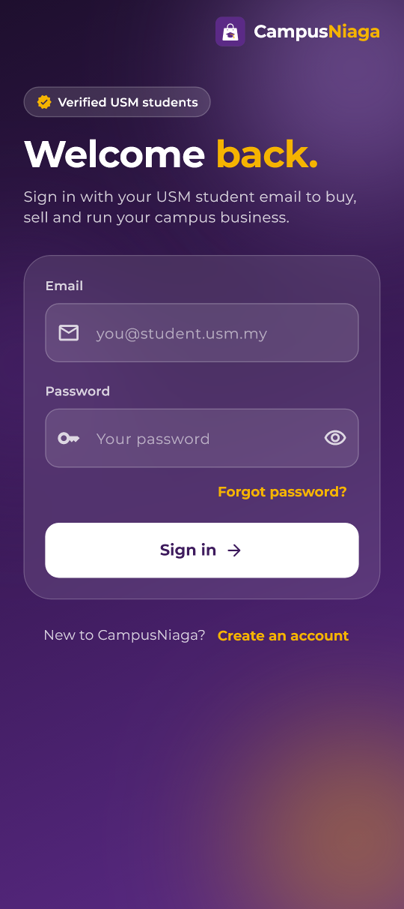<br><sub><b>Sign in</b><br>USM student email only</sub></td>
    <td align="center" width="25%">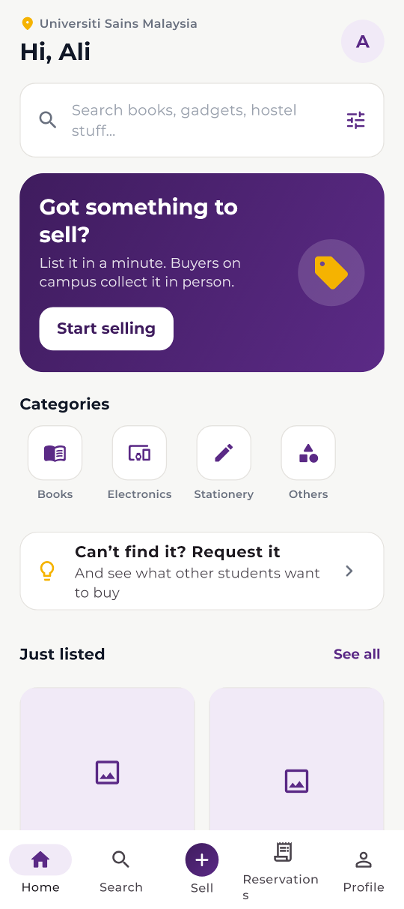<br><sub><b>Home</b><br>Categories and new listings</sub></td>
    <td align="center" width="25%">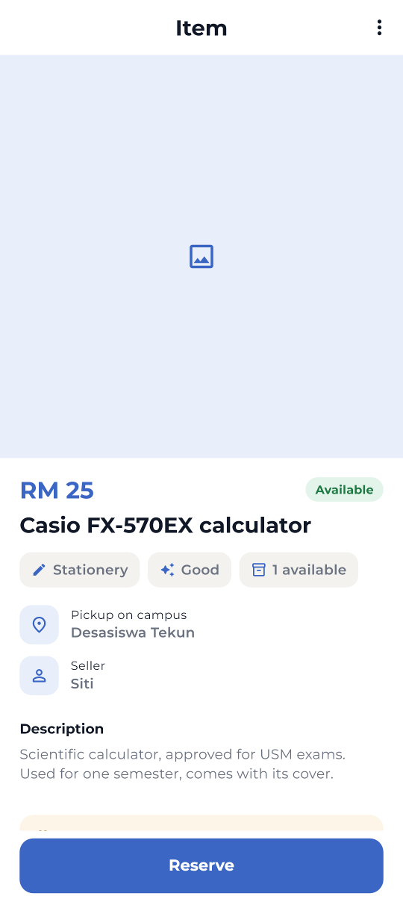<br><sub><b>Listing</b><br>Reserve for campus pickup</sub></td>
    <td align="center" width="25%">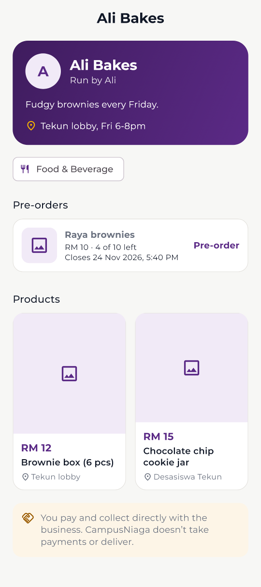<br><sub><b>Storefront</b><br>Products and pre-orders</sub></td>
  </tr>
  <tr>
    <td align="center">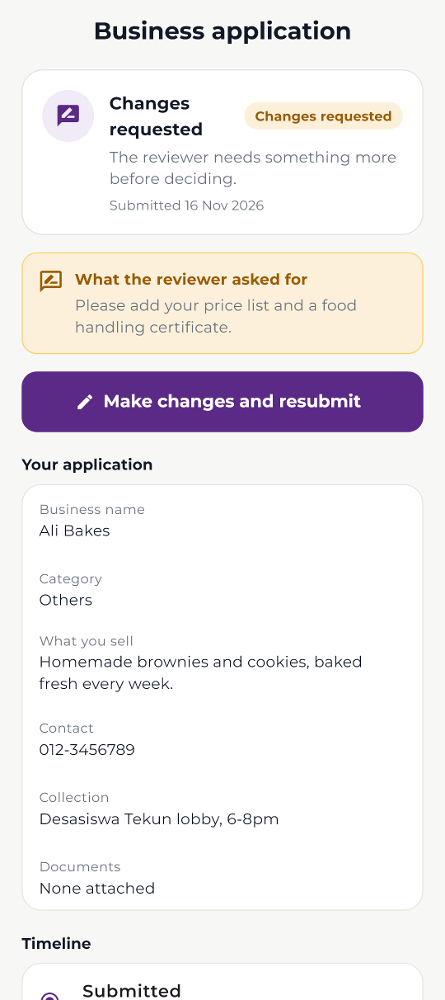<br><sub><b>Business application</b><br>Reviewer feedback and timeline</sub></td>
    <td align="center">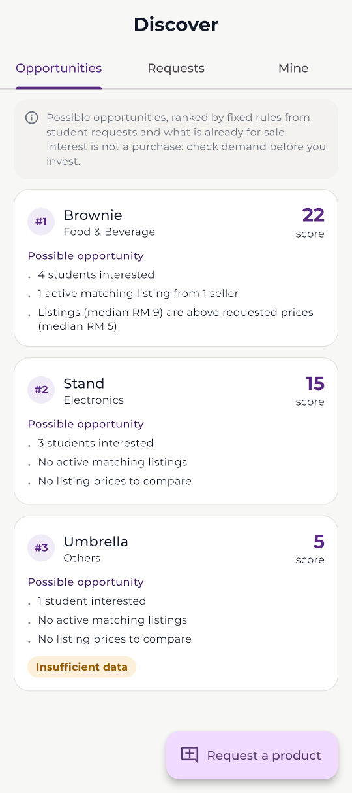<br><sub><b>Discover</b><br>Ranked possible opportunities</sub></td>
    <td align="center">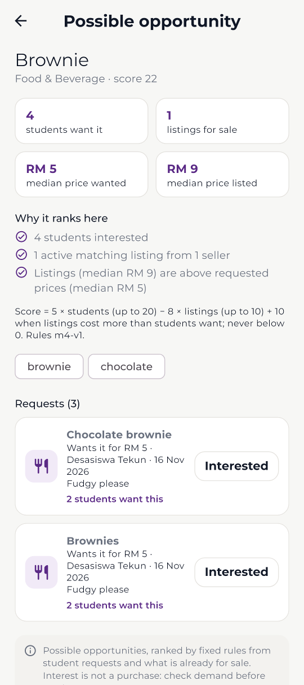<br><sub><b>Opportunity</b><br>The numbers behind the score</sub></td>
    <td align="center">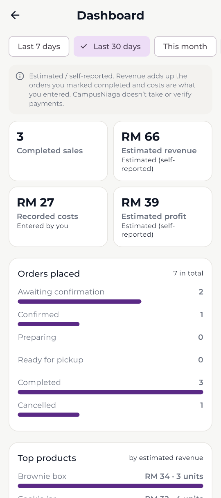<br><sub><b>Dashboard</b><br>Estimated, self-reported figures</sub></td>
  </tr>
  <tr>
    <td align="center">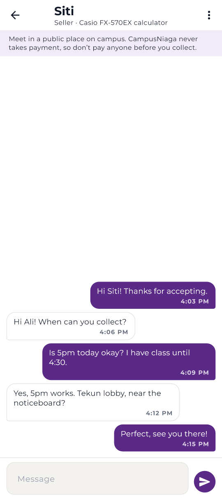<br><sub><b>Deal chat</b><br>Arrange pickup, live</sub></td>
    <td align="center">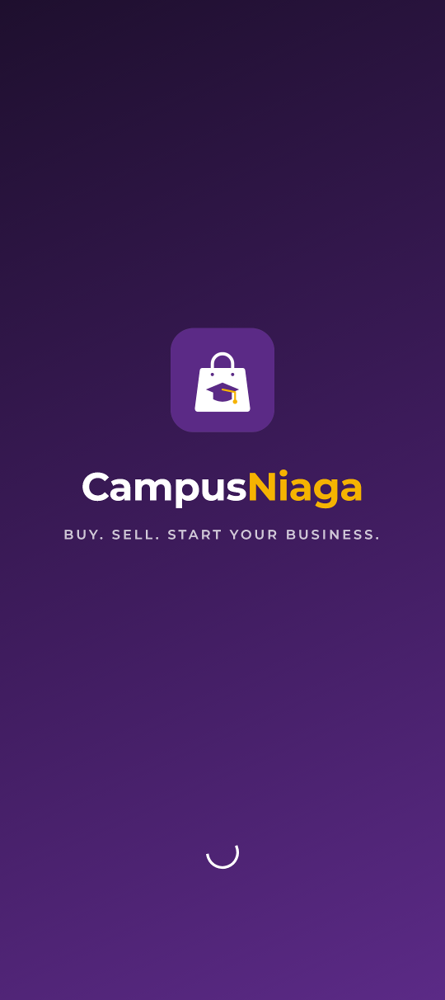<br><sub><b>Splash</b><br>USM purple and gold</sub></td>
    <td></td>
    <td></td>
  </tr>
</table>

### 🖥️ Reviewer and admin dashboard

<table>
  <tr>
    <td align="center" width="50%">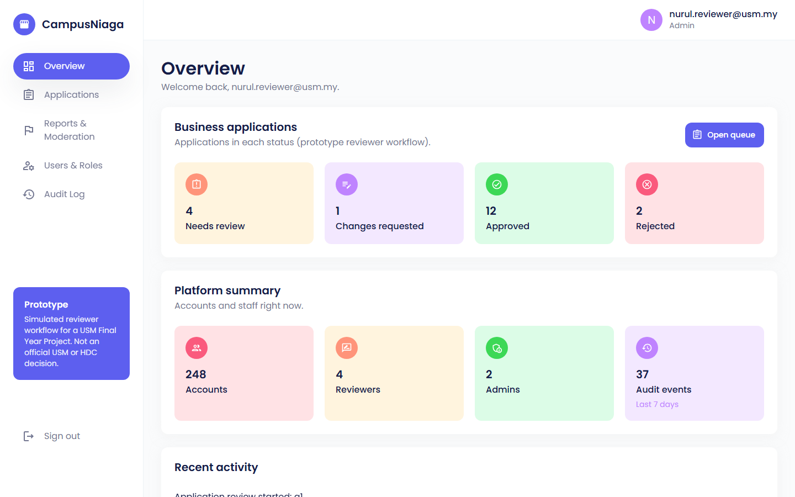<br><sub><b>Overview</b>: applications by status, platform summary, recent activity</sub></td>
    <td align="center" width="50%">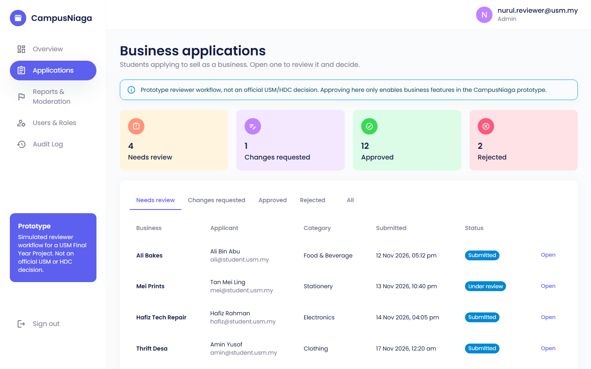<br><sub><b>Applications</b>: the reviewer queue, oldest first</sub></td>
  </tr>
  <tr>
    <td align="center" colspan="2">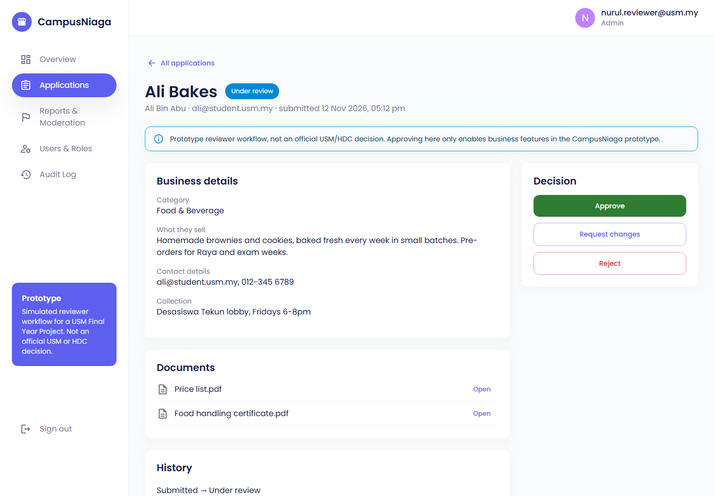<br><sub><b>Application detail</b>: business details, private documents, history and the decision panel</sub></td>
  </tr>
</table>

<sub>The screenshots show demo data. See <a href="docs/deployment.md#-refreshing-the-readme-screenshots">how to refresh them</a>.</sub>

## 🏗️ Architecture

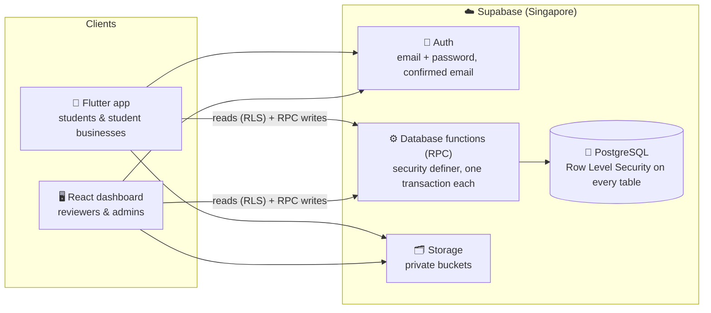

| Part | Technology | Users |
|---|---|---|
| [`mobile/`](mobile/) | Flutter, Dart 3, Riverpod, go_router, supabase_flutter | USM students and approved student businesses |
| [`admin/`](admin/) | React 19, TypeScript (strict), Vite, MUI, TanStack Query | University reviewers and system administrators |
| [`supabase/`](supabase/) | PostgreSQL, Row Level Security, database functions, Auth, Storage | Trusted backend |

**Design principles**

- 🔒 **The server is the authority.** Roles, approvals, stock, pre-order capacity, order status, rankings and the audit log change only inside database functions. Hiding a button is never the security.
- 🎫 **Privileges are read live** from server-controlled tables (`staff_roles`, `businesses`, the confirmed email) on every request, never from a client-writable column or a login token.
- 🔁 **Conflicts are settled in one transaction** with row locks (`select … for update`), so two buyers can never take the last unit.
- 💰 **Money is an integer in sen.** RM appears only on screen.
- 🧮 **Discovery is deterministic.** Fixed, versioned rules with no machine learning, and every result stores its version and parameters.

The backend is Supabase instead of the handoff's Firebase; [ADR 0003](docs/decisions/0003-move-backend-to-supabase.md) explains why.

## 🔄 How it works

<details>
<summary><b>📝 Business application lifecycle (M2)</b></summary>

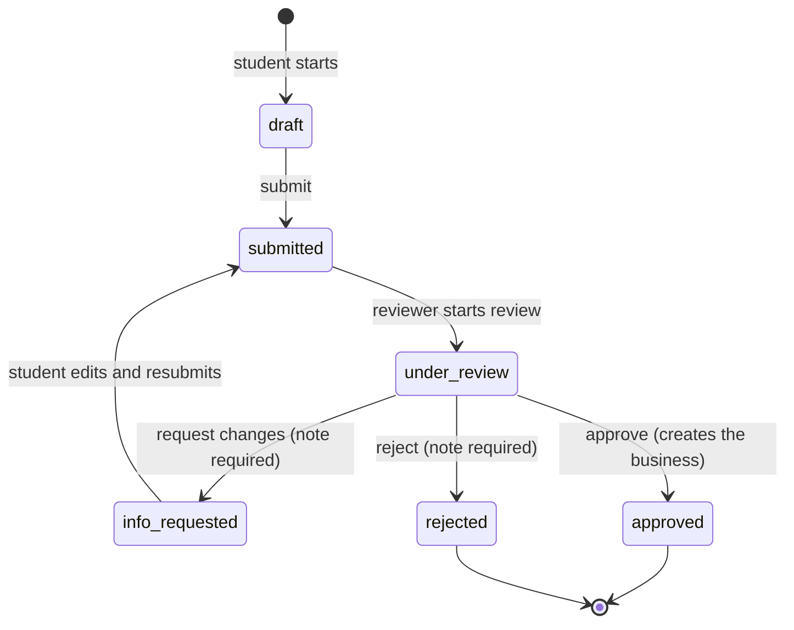

Every move is checked by `review_business_application` / `submit_business_application`, stored in the status history and written to the audit log. Staff can't review their own application.

</details>

<details>
<summary><b>🧾 Order lifecycle (M3)</b></summary>

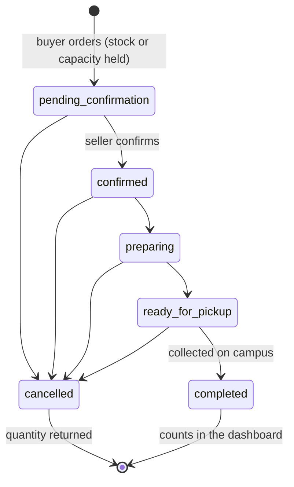

</details>

<details>
<summary><b>💡 How opportunities are ranked (M4)</b></summary>

1. Each product request is normalised: lower case, English and campus-Malay stop words removed, simple plurals made singular, and a curated synonym list applied.
2. Requests with the same category and head term form one cluster, for example `Food & Beverage | brownie` for "brownie", "brownies" and "chocolate brownie".
3. For each cluster: **D** = distinct students who asked or tapped *Interested* (each counted once), **S** = visible matching listings.
4. The score is

   ```
   score = max(0, 5 × min(D, 20) − 8 × min(S, 10) + 10 if listings cost more than students want)
   ```

5. Each result is stored with its reasons ("4 students interested", "1 active matching listing from 1 seller", the two median prices), `algo_version = m4-v1` and its parameters. Fewer than 2 students is flagged as *insufficient data*. Triggers recompute the results whenever requests, interest or listings change.

</details>

## 🧪 Quality and testing

| Suite | What runs | Result |
|---|---|---|
| 🐘 Database (pgTAP) | 22 files against a fresh local Supabase in CI: every policy, privilege, function, transition and limit | **958 / 958** |
| ⚡ Concurrency | Two real connections racing for the last unit and the last pre-order place | **2 / 2** |
| 📱 Flutter | Unit and widget tests through the real router, with in-memory repositories | **215 / 215** |
| 🖥️ React | Vitest + Testing Library | **70 / 70** |
| 🧬 Mutation testing | Bugs planted on purpose to check that the tests catch them (Phases 3–6 and the chat) | **155 of 157 caught** |

CI ([`ci.yml`](.github/workflows/ci.yml)) runs format checks, analysis, lint, type checks, all tests and `supabase db lint` on every pull request. Every handoff phase has its pass condition as an automated test. The full record is in the [test plan and results](docs/qa/test-plan-and-results.md); usability sessions use the [usability test kit](docs/qa/usability-test-kit.md).

## 🚀 Try it

| | How |
|---|---|
| 📱 **Android app** | Download the APK from the [latest release](https://github.com/asyrafmika/CampusNiaga/releases/latest) and open it on an Android phone. Sign in with a confirmed `@student.usm.my` account |
| 🖥️ **Admin dashboard** | Open **[asyrafmika.github.io/CampusNiaga](https://asyrafmika.github.io/CampusNiaga/)** and sign in with a reviewer or admin account. Student accounts are signed out with a "staff only" message |

Releases and Pages are built by GitHub Actions: [`release-apk.yml`](.github/workflows/release-apk.yml) on each version tag and [`admin-pages.yml`](.github/workflows/admin-pages.yml) on each change to `admin/`.

## 📂 Repository layout

```
CampusNiaga/
├─ mobile/                 📱 Flutter student app (feature-first: core/, features/*)
├─ admin/                  🖥️ React reviewer/admin dashboard
├─ supabase/
│  ├─ migrations/          versioned SQL: tables, RLS, database functions, storage
│  └─ tests/               pgTAP tests and two-connection race tests
├─ docs/                   data dictionary, API contracts, ADRs, QA, deployment
└─ .github/workflows/      CI, Android release, admin deployment
```

## ✅ Development status

| Phase | Scope | Status |
|---|---|---|
| 1 Foundation | Project setup, sign-in, USM student check, staff-only web access | ✅ Done |
| 2 Marketplace | Listings, search, reservations, reports | ✅ Done |
| 3 Approval | Business application and reviewer workflow (simulated) | ✅ Done |
| 4 Business | Storefront, stock, pre-orders, orders | ✅ Done |
| 5 Discovery | Product requests, interest, opportunity ranking | ✅ Done |
| 6 Dashboard + QA | Seller analytics, final testing | ✅ Done (usability sessions to run: [kit](docs/qa/usability-test-kit.md)) |
| + Deal chat | Buyer–seller chat inside an agreed deal ([ADR 0004](docs/decisions/0004-deal-chat.md), a scope change after the handoff) | ✅ Done |

<details>
<summary><b>🔍 How each phase's pass condition is proven</b></summary>

### Phase 1 check

The handoff's Phase 1 pass condition is that a USM student gets in, a non-USM email is refused, and a student can't open staff features. These automated tests prove it, and CI runs them on every pull request:

| Part | Test | What it proves |
|---|---|---|
| Database | `supabase/tests/database/04_phase1_pass_condition.test.sql` | The whole journey: sign up, held until the email is confirmed, then let in; a confirmed gmail account refused; the student can't grant itself a role or read staff data; a role given by an admin works on the next request and its removal does too, both audited |
| Mobile | `mobile/test/app_navigation_test.dart` | A verified student reaches home; a non-USM account stops at "CampusNiaga is for USM students"; a suspended account stops at "Account suspended" |
| Admin | `admin/src/features/auth/components/RequireStaff.test.tsx` | A student who signs in to the dashboard is signed out with a "staff only" message; a reviewer can't open admin pages |

The rules are enforced by the database, so the database test is the one that matters most; the app tests check that each app shows the right screen for the answer it gets.

### Phase 2 check

The handoff's Phase 2 pass condition is that a student publishes an item, a second student finds and reserves it, a simultaneous reservation cannot double-book it, and the seller marks it sold.

| Part | Test | What it proves |
|---|---|---|
| Database | `supabase/tests/database/08_phase2_pass_condition.test.sql` | The journey: Ali publishes a calculator with a photo; Siti finds it by searching and reserves it; Amin's request for the same item is refused (`ITEM_UNAVAILABLE`); Ali accepts, Siti then sees Ali's email, and Ali marks it collected, which sells it |
| Database, two connections | `supabase/tests/concurrency/reservation_race.sh` | Two buyers reserve the last unit at the same moment on separate connections. The second waits for the first's row lock, then is refused; exactly one reservation exists |
| Database | `05_listings`, `06_reservations`, `07_moderation` | Every rule on its own: who may list, reserve, resolve, report and moderate; stock never goes below zero; expiry returns units; contact details stay hidden until acceptance |
| Mobile | `mobile/test/features/marketplace/` | The screens: browse, search and filter, reserve (with quantity), refused reservations show the reason, publish, the listing form, accept a request, report, profile |
| Admin | `admin/src/features/moderation/pages/ModerationPage.test.tsx` | Hide a listing, suspend a seller, dismiss a report |

### Phase 3 check

The handoff's Phase 3 pass condition is: submit → reviewer requests edits → applicant edits and resubmits → approve; business features are unavailable before approval; every change is audited. The approval is a **simulated** reviewer workflow for the FYP, not an official USM/HDC decision, and both apps say so.

| Part | Test | What it proves |
|---|---|---|
| Database | `supabase/tests/database/11_phase3_pass_condition.test.sql` | The journey: Ali drafts an application with a document and submits it; the reviewer starts the review and asks for a price list; Ali reads the note, edits and resubmits with a reply; the reviewer approves. `get_my_business()` refuses Ali (`FORBIDDEN`) until approval and works straight after; the business row exists; the status history and the audit log both hold all six steps in order, with who did each |
| Database | `09_business_applications`, `10_businesses` | Every (status, action) pair: allowed moves succeed, every other one fails with `INVALID_TRANSITION`. Applicants can't change status, reviewer or dates; drafts stay private from staff; other students see nothing; documents follow the same rules; reject and request-info need a note; no second business; suspension removes business access at once and reinstating restores it; the status summary counts by status |
| Mobile | `mobile/test/features/business/application/` | Apply, save a draft, upload a document, submit; respond to a request for changes and resubmit with a reply; the timeline; approved and rejected states; refused submissions show the reason |
| Admin | `admin/src/features/applications/` | The queue and status summary; only the decisions the state machine allows; a note is required to request changes or reject; approval is confirmed with the disclaimer; reviewers can't decide their own application; admins suspend a business |

### Phase 4 check

The handoff's Phase 4 pass condition is: an approved seller creates a storefront, a product and a campaign; two buyers cannot exceed the remaining stock or capacity; cancellations free the quantity.

| Part | Test | What it proves |
|---|---|---|
| Database | `supabase/tests/database/14_phase4_pass_condition.test.sql` | The journey: before approval Ali can't list business products or set up a storefront; the reviewer approves; Ali sets up the storefront, lists a 2-unit brownie box and opens a capacity-3 pre-order. Siti takes both boxes and Amin is refused (`ITEM_UNAVAILABLE`); Siti pre-orders 2, Amin can't take 2 (`CAPACITY_FULL`) but takes the last place, and a fourth is refused. Siti cancels both: the boxes are back on sale and 2 places free up, and Amin gets them. Units ordered plus stock left always equal 2, and pre-ordered units always equal the allocation |
| Database, two connections | `supabase/tests/concurrency/order_race.sh` | Two buyers order the last unit, then the last pre-order place, at the same moment on separate connections. Each time the second waits for the first's row lock and is refused; exactly one order each |
| Database | `12_business_listings`, `13_campaigns_orders` | Every rule on its own: only approved businesses list business products, suspension removes them from the feed and the storefront at once, business products can't be reserved, every campaign and order limit (stock, capacity, per-order limit, dates), every (status, action) pair for orders, who may read campaigns and orders, contact emails only after confirmation |
| Mobile | `mobile/test/features/business/store/` | Order from stock or a pre-order (capped by what is left and the per-order limit), the storefront, a sold-out product, refused orders, cancel from My orders; the business confirms orders, opens and creates pre-orders, edits its storefront and adds business products |

### Phase 5 check

The handoff's Phase 5 pass condition is: synonym requests cluster, one student counts once, existing supply lowers the score, a price gap affects the result, and the reasons match the data. The ranking is deterministic (no machine learning): fixed text rules, a curated synonym list and the handoff's score, `max(0, 5 × min(D, 20) − 8 × min(S, 10) + 10 if listings cost more than students want)`, stored with its version (`m4-v1`) and parameters.

| Part | Test | What it proves |
|---|---|---|
| Database | `supabase/tests/database/17_phase5_pass_condition.test.sql` | The handoff fixture: "brownie", "brownies" and "chocolate brownie" from three students form one cluster (`Food & Beverage\|brownie`). Ali, who asked already, taps Interested on the other two and Mei taps all three, yet D = 4. A competing listing makes S = 1 and lowers the score by 8 (20 → 12); raising its price above what students want adds 10 (→ 22). The reasons state "4 students interested", "1 active matching listing from 1 seller" and the two median prices, exactly the stored numbers, and the stored score follows the formula |
| Database | `15_product_requests`, `16_opportunities` | The text rules (stop words in English and campus Malay, plurals, synonyms, head term), one active request per cluster, interest toggling and rate limits, privacy (nobody sees who asked or who is interested), the caps and the floor of the score, what counts as supply (not hidden, closed, suspended sellers or suspended businesses), insufficient data, ranking and tie-breaks, and the triggers that keep results current |
| Mobile | `mobile/test/features/discovery/` | The ranked list labelled "Possible opportunity" with its reasons and insufficient-data flag, the opportunity page with its numbers and formula, Interested, requesting a product, closing one's own request, refused taps |

### Phase 6 check

The handoff's Phase 6 pass condition is: completed orders update the estimated analytics; seller A cannot read seller B's data; functional, scenario and usability tests are conducted. Revenue and profit are labelled estimated / self-reported, because CampusNiaga doesn't take or verify payments.

| Part | Test | What it proves |
|---|---|---|
| Database | `supabase/tests/database/19_phase6_pass_condition.test.sql` | Pending orders aren't sales; completing an order through every status adds it to Ali's dashboard (RM 24), recording a RM 9 cost gives RM 15 estimated profit, a second sale updates every figure and the top product. Ali can't read, progress or cost Nina's order, Nina's dashboard shows none of Ali's sales, and the dashboard function takes no business id at all |
| Database | `18_business_dashboard` | Every figure, date ranges (start inclusive, end exclusive), costs never shown to buyers, suspended businesses refused |
| Scenario | `20_end_to_end_scenario` | The handoff's minimal fixture through all five modules in one run |
| Mobile | `mobile/test/features/dashboard/` | The period filter, the estimated labels, the figures and record cost |
| QA | [docs/qa/test-plan-and-results.md](docs/qa/test-plan-and-results.md) | Functional and scenario testing: requirements mapped to tests, results, mutation testing; [usability-test-kit.md](docs/qa/usability-test-kit.md) for the sessions with students |

</details>

## 🚀 Getting started

Prerequisites: Flutter (stable) with an Android emulator, and Node.js 22+ (only for running the Supabase CLI with `npx`).

### 1️⃣ Create the Supabase project (once)

1. Sign in at [supabase.com](https://supabase.com) and create a project named **CampusNiaga**, region **Southeast Asia (Singapore)**. Save the database password in a password manager; it is never stored in this repository.
2. **Authentication → Sign In / Providers → Email:** keep it enabled, with **Confirm email** on. CampusNiaga only treats confirmed `@student.usm.my` addresses as students.
3. **Authentication → URL Configuration → Redirect URLs:** add `campusniaga://auth-callback`. Links in confirmation and password-reset emails then open the app.
4. **Authentication → Emails → SMTP Settings:** turn on custom SMTP. Supabase's built-in sender allows about 2 emails an hour and only to your project team, so students can't receive confirmation emails without it. A Gmail account with an app password works for a prototype (host `smtp.gmail.com`, port `465`).

### 2️⃣ Apply the database migrations

From the repository root:

```bash
npx supabase@2.122.0 login
npx supabase@2.122.0 link --project-ref <your-project-ref>
npx supabase@2.122.0 db push
```

The project ref is the part of the project URL before `.supabase.co`. `db push` applies every migration in `supabase/migrations/` that the project doesn't have yet.

### 3️⃣ Make yourself an admin

Sign up in the app first (step 4️⃣), then in the dashboard's **SQL Editor** run:

```sql
insert into public.staff_roles (user_id, role)
select id, 'admin' from auth.users where email = 'your.email@student.usm.my';
```

After that, grant reviewer and admin roles from the admin dashboard's **Users & Roles** page (step 5️⃣). Each change is written to the audit log.

### 4️⃣ Run the mobile app

1. In the dashboard, open **Project Settings → API** (Project URL) and **API Keys** (the **publishable** key). Paste both into `mobile/lib/core/config/supabase_config.dart`. The publishable key is designed to be public. Never paste the secret / `service_role` key.
2. Start an Android emulator and run the app:

```bash
flutter emulators --launch Pixel_9
cd mobile
flutter pub get    # first time only
flutter run
```

The first launch shows the onboarding slides, then **Sign in**. Use **Create an account** with your USM email and confirm it from your inbox. If you open the link on the phone, it signs you in straight away; otherwise, sign in after confirming.

Once signed in, the bottom bar has **Home** (newest listings and categories), **Search** (words, filters, sorting), **Sell** (the listing form: up to 5 photos from the camera or gallery, resized on the phone), **Bookings** (your reservations, buying and selling) and **Profile** (My Listings, sign out). Payment and pickup are arranged between the students; the app never takes payments.

**Images:** put these in `mobile/assets/images/`; until then the app shows placeholders.

| File | Where | Format |
|---|---|---|
| `onboarding_1.jpg`, `onboarding_2.jpg`, `onboarding_3.jpg` | The three onboarding slides | Portrait photos, about 1080 px wide |

Checks:

```bash
cd mobile
flutter analyze
dart format --output=none --set-exit-if-changed lib test
flutter test
```

### 5️⃣ Run the admin dashboard

The web dashboard is for reviewers and admins. It uses the same Supabase project; its URL and publishable key are in `admin/src/shared/supabase/client.ts`.

```bash
cd admin
npm install        # first time only
npm run dev        # open http://localhost:5173
```

Sign in with a staff account (step 3️⃣). A student account is signed out with a "staff only" message. Checks: `npm run typecheck`, `npm run lint`, `npm test`. See [admin/README.md](admin/README.md) for its pages and structure.

You don't need to run the dashboard to use the mobile app, or the other way round: both talk to the hosted Supabase project directly.

### 🐘 Database tests

The pgTAP tests in `supabase/tests/database/` run in GitHub Actions on every pull request, against a throwaway local Supabase database. Running them locally needs Docker (`npx supabase@2.122.0 start`, then `npx supabase@2.122.0 test db`).

### ⚠️ Free-plan notes

- A free project **pauses after a week without activity**. Open the dashboard and restore it before a demo.
- The free plan has no automatic backups.

## 📚 Documentation

| Document | What it covers |
|---|---|
| 📖 [Data dictionary](docs/data-dictionary.md) | Every table, column, status value and storage bucket |
| 🔌 [API contracts](docs/api-contracts.md) | The database functions the apps call, their inputs, outputs and errors |
| 🧭 [Architecture decisions](docs/decisions/) | Why the main technical choices were made (ADRs) |
| 🧪 [Test plan and results](docs/qa/test-plan-and-results.md) | Every requirement mapped to its tests, the results and a manual checklist |
| 👥 [Usability test kit](docs/qa/usability-test-kit.md) | Tasks, observation sheet and SUS questionnaire for sessions with students |
| 🚢 [Deployment](docs/deployment.md) | Android releases, the signing key, GitHub Pages for the dashboard |
| 🖥️ [Admin dashboard](admin/README.md) | Its pages, checks and structure |

## 🙏 Credits

- Final Year Project (CAT404), Universiti Sains Malaysia.
- [Montserrat](https://fonts.google.com/specimen/Montserrat) and [Poppins](https://fonts.google.com/specimen/Poppins) fonts under the SIL Open Font License.
- UI inspired by the Nestora and Pixel Market mobile kits and the Dabang dashboard.

<p align="center"><sub>Made with 💙 for USM students · CampusNiaga is a prototype, not an official USM service</sub></p>
